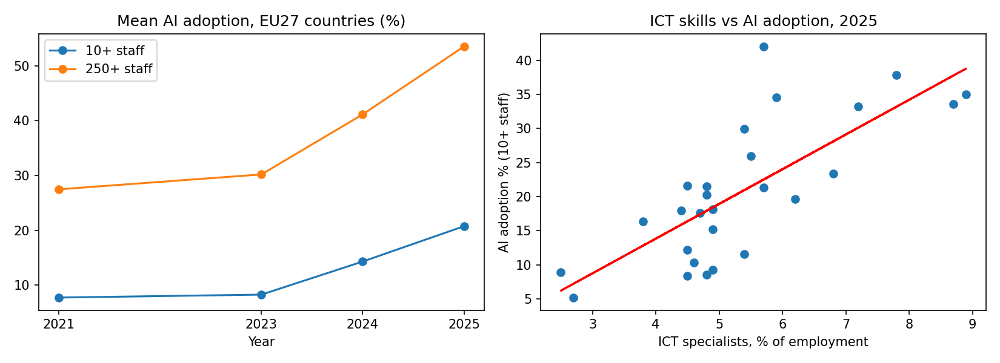
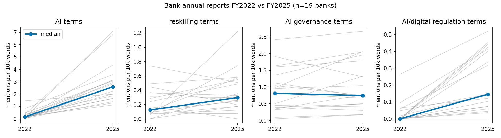
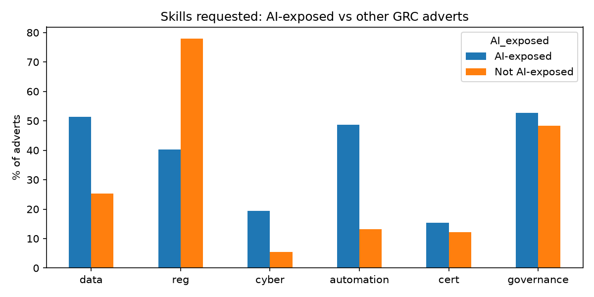

# CHAPTER 4 - DATA ANALYSIS AND INTERPRETATION

## 4.1 INTRODUCTION

This chapter presents the analysis in the order of the research design. Section 4.2 describes the respondents. Section 4.3 presents the thematic analysis of the interviews, and Section 4.4 the descriptive analysis of the questionnaire. Section 4.5 analyses the secondary evidence on AI adoption, regulation, job descriptions and workforce practices. Section 4.6 reports the statistical tests of hypotheses H5–H10 on public data. Section 4.7 triangulates all the evidence against the propositions. Sections 4.8 and 4.9 present the two main outputs of the study: the GRC role-impact map and the workforce transformation framework. Section 4.10 maps the deliverables to the analysis.

## 4.2 PROFILE OF RESPONDENTS

Table 4.1 summarises the profile of the primary-data respondents. In line with the anonymity commitments given to participants, the profile is described qualitatively.

Table 4.1 Profile of respondents

| Element | Interviews | Questionnaire |
|---|---|---|
| Functions | Enterprise data architecture and enterprise architecture supporting GRC service lines; technology professionals working on operational resilience; senior consulting leadership | Internal audit, risk and GRC technology |
| Levels | Senior professionals and leaders | Analyst, manager and senior manager |
| Jurisdiction | UK and dual UK/EU responsibilities | UK, EU and dual jurisdictions |
| Organisation type | Banks, banking service providers and consultancies serving banks | Banking service providers and global capability centres |
| AI maturity in own area | From no AI use with established automation, through pilots only, to AI used in some processes; no respondent reported extensive use | |
| Collection | Written interview through an online form, September 2026 | Online questionnaire, September 2026 |

The respondent group is senior and leans towards technology and architecture roles. This gives an informed view of how AI is being introduced, but under-represents first-line compliance staff and HR business partners. The findings are interpreted with this in mind.

## 4.3 THEMATIC ANALYSIS OF INTERVIEW DATA

Open coding of the written interviews produced ten themes. They are presented below by objective, with illustrative verbatim evidence.

### 4.3.1 Objective (i): activities automated or augmented, and role demand

Table 4.2 Interview themes for Objective (i)

| Theme | Finding | Illustrative evidence (verbatim) |
|---|---|---|
| T1. Automation precedes AI; a wide pilot-to-production gap | Rules-based automation of regulatory monitoring and reporting, governance workflows, control-testing support and data aggregation is established. AI (document analysis, regulatory change assessment, enhanced risk scoring, compliance monitoring) is largely at pilot stage. Production AI uses are specific: reconciliation and documentation of complex process flows, and identifying vulnerabilities and developing test scenarios for operational resilience. | "I don't actually see it working in my experience. I have only ever seen pilot." |
| T2. Routine work is absorbed; judgement work resists | Most affected: data collection and consolidation for compliance reporting, control monitoring, regulatory reporting workflows, MI and dashboards, data mapping and design diagrams. Resistant: challenging risk decisions, control design, agreeing remediation, assurance to senior stakeholders and regulators, and operations-specific knowledge of complex flows and regulation. | "Tasks with structured inputs, defined rules and repeatable processes were generally easier to automate. Activities involving ambiguity, interpretation of regulatory intent, business context, or balancing competing risks continued to rely heavily on experienced practitioners." |
| T3. Roles are recomposed; testing roles contract first | Material time savings in data analysis, source-file comparison, cross-format reconciliation, requirements interviewing, and design and architecture diagramming. Freed capacity is redirected to review and higher-order design. | "GRC Testing Roles have disappeared." |

**Interpretation.** The pattern matches Autor's (2015) distinction between substitution and complementarity. Tasks with structured inputs and fixed rules are substituted, while tasks that require interpretation and judgement are complemented. The gap between pilots and production also means that much of the workforce impact is still ahead.

### 4.3.2 Objective (ii): regulation, human oversight and competence

Table 4.3 Interview themes for Objective (ii)

| Theme | Finding | Illustrative evidence (verbatim) |
|---|---|---|
| T4. Expert human review is non-negotiable | AI output is not reliably accurate word for word, depends on input data quality and can hallucinate. Meaningful challenge needs business and regulatory knowledge, understanding of the data, awareness of AI failure modes and the confidence to apply judgement. | "AI output needs human and expert review to be used." / "Inaccurate insights and outputs can result in reputational damage and financial penalties." |
| T5. An accountability gap at the top | Senior executives accountable under SM&CR and DORA may lack the understanding needed to challenge AI, creating a risk of automation bias. | "C-level execs really do not understand what the AI is, and thus are likely to simply trust it." |
| T6. Regulation is felt unevenly in practice | Some practitioners see no practical regulatory effect yet, and one judged the regulatory environment inadequate to protect. Others see regulatory exposure as the factor that sustains human validation. | "At the moment, the regulatory environment is woefully lacking in the ability to protect." / "None so far." |

**Interpretation.** Practitioners accept that human review is required, but the people who are formally accountable may be the least able to provide it. This is the risk that Glikson and Woolley (2020) describe: where users cannot see into a system, they tend either to distrust it entirely or to trust it uncritically.

### 4.3.3 Objective (iii): skill gaps and reskilling

Table 4.4 Interview themes for Objective (iii)

| Theme | Finding | Illustrative evidence (verbatim) |
|---|---|---|
| T7. A hybrid skill profile | AI, data, cyber, automation and resilience skills are increasingly critical. The largest gaps are in AI risk, analytics and risk quantification. Reviewer skills (attention to detail, ability to parse large volumes of generated content) are rising in importance. | "AI, data, cyber, automation, and resilience skills are increasingly critical, with gaps in AI risk, analytics, and risk quantification." |
| T8. Loss of institutional knowledge is the hidden risk | Critical knowledge sits with long-serving subject-matter experts. Cutting headcount before capturing it undermines the capacity to validate AI. | "Too much business knowledge exists in people's heads, and if that knowledge is lost, it becomes much harder to validate, challenge and govern AI-generated outputs effectively. I would prioritise knowledge capture and transfer before any significant workforce reductions." |
| T9. Build, buy and borrow, with specialist gaps persisting | Training existing staff, targeted hiring and vendor or technology support are combined. Training works for general tool use, but specialist gaps remain. Suggested remedies: dedicated learning modules for each regulation in each domain, and prompts pre-embedded in AI tools. | "A mix of training, targeted hiring, and technology/vendor support is helping, but specialist skill gaps remain." |

**Interpretation.** The skills required are hybrid: technical fluency is needed to understand AI output, and domain judgement is needed to challenge it. Theme T8 is an emergent finding that was not anticipated in the literature review. It means that the experts whose routine work is automated are also the people needed to validate the automation.

### 4.3.4 Objective (iv): employee behavioural responses

Table 4.5 Interview themes for Objective (iv)

| Theme | Finding | Illustrative evidence (verbatim) |
|---|---|---|
| T10. Ease of use welcomed; anxiety and weak change management persist | Confidence is growing alongside concern about job impact and accuracy. Junior staff are particularly worried. Trust depends on the ability to understand and validate output. Business change management is described as weak. Where management did well, it communicated and demonstrated how AI helps daily work. | "People have embraced the ease of use and accessibility." / "There have been many low level resources very worried." / "My experience is that Business Change Management is Weak." |

**Interpretation.** The response to AI is mixed rather than hostile. Ease of use supports adoption, as TAM predicts (Davis, 1989), but anxiety among junior staff is consistent with the STARA effects described by Brougham and Haar (2018), and weak change management amplifies it.

## 4.4 ANALYSIS OF QUESTIONNAIRE DATA (DESCRIPTIVE STATISTICS)

The questionnaire results are reported as means and standard deviations on the five-point scale, where 3 is the neutral midpoint. They are descriptive results from a small purposive sample and are not generalised.

Table 4.6 Item-level descriptive statistics (scale 1–5)

| Construct | Item | Mean | SD |
|---|---|---|---|
| A. Usefulness | 7. AI improves my performance | 4.00 | 1.00 |
| | 8. AI increases the volume of work I can complete | 3.33 | 0.58 |
| | 9. AI improves the quality and consistency of outputs | 3.33 | 1.15 |
| | 10. Overall, AI tools are useful in my job | 3.67 | 0.58 |
| B. Ease of use | 11. Tools are easy to use | 4.33 | 0.58 |
| | 12. Easy to understand what tools are doing | 3.33 | 0.58 |
| | 13. Learning did not require excessive effort | 4.33 | 0.58 |
| C. Trust | 14. I understand how tools arrive at outputs | 3.67 | 0.58 |
| | 15. Outputs are reliable | 3.67 | 0.58 |
| | 16. I could defend an AI-assisted decision to a regulator or auditor | 4.33 | 0.58 |
| | 17. Comfortable relying on output without re-performing work | 3.67 | 1.15 |
| | 18. Effective way to challenge or override AI output | 4.00 | 1.00 |
| D. Replaceability (higher = more concern) | 19. Concerned a significant part of my role could be done by AI | 3.33 | 1.53 |
| | 20. My role will change substantially in three years | 4.33 | 0.58 |
| | 21. Concerned about long-term career prospects | 4.00 | 1.00 |
| E. Skills | 22. My current skills are sufficient | 3.67 | 1.15 |
| | 23. Organisation has provided adequate training | 3.33 | 1.53 |
| | 24. Data and analytical skills are more important | 4.00 | 1.00 |
| | 25. Judgement and regulatory reasoning are more important than routine processing | 4.00 | 1.00 |
| F. Oversight | 26. Accountable people have the knowledge to supervise AI decisions | 4.00 | 1.00 |
| | 27. Human-oversight requirements are clearly reflected in practice | 3.67 | 1.15 |
| G. Organisational response | 28. Management communicated clearly on role impact | 4.00 | 1.00 |
| | 29. I feel positive about AI's effect on my work | 4.00 | 1.00 |
| | 30. I would consider leaving because of AI (higher = more intent) | 3.67 | 1.15 |
| | 31. I feel committed to my organisation | 4.00 | 1.00 |

Table 4.7 Construct composite scores

| Construct | Mean | SD | Interpretation |
|---|---|---|---|
| A. Perceived usefulness | 3.58 | 0.72 | Moderately positive; strongest on individual performance, weakest on volume and quality |
| B. Perceived ease of use | 4.00 | 0.33 | Highest construct; tools are easy to operate and learn |
| C. Trust in AI output | 3.87 | 0.50 | Positive but conditional |
| D. Perceived replaceability (concern) | 3.89 | 0.96 | Change strongly expected; personal concern more varied |
| E. Skills and reskilling | 3.75 | 1.09 | Data and judgement skills rising; training adequacy is the lowest item |
| F. Oversight and accountability | 3.83 | 1.04 | Oversight present; operational clarity weaker |
| G. Organisational response (item 30 reversed) | 3.58 | 0.52 | Communication and commitment positive; some intent to leave |

Table 4.8 Assessment of questionnaire hypotheses H1–H4

| Hypothesis | Measure | Mean (SD) | Result |
|---|---|---|---|
| H1: tools are useful | Construct A | 3.58 (0.72) | Above the midpoint; supported descriptively |
| H2: tools are easy to use | Construct B | 4.00 (0.33) | Above the midpoint; highest construct; supported descriptively |
| H3: roles will change substantially | Item 20 | 4.33 (0.58) | Above the midpoint, with the lowest dispersion; supported descriptively |
| H4: trust is conditional (item 17 < item 15) | Item 17 vs item 15 | 3.67 (1.15) vs 3.67 (0.58) | Equal means, so not supported on the means. Reliance without re-performance is more dispersed, and confidence in defending a decision (item 16: 4.33) exceeds comfort in relying on output (item 17: 3.67). Partly supported, with qualitative support from T4. |

**Key inferences from the questionnaire.**

1. **Usability–transparency gap.** Ease of use (items 11 and 13: 4.33) is clearly higher than understanding what the tool is doing (item 12: 3.33). Tools are easy to operate but not easy to see into. This is consistent with interview theme T10 and with the transparency dimension of cognitive trust (Glikson & Woolley, 2020).
2. **Conditional trust.** Practitioners keep a human check in place even when they rate outputs as reliable. Comfort in relying on AI output without re-performing the work is the more dispersed rating, which supports T4.
3. **Change is accepted as inevitable.** The expectation that roles will change substantially (item 20: 4.33) is the strongest and most consistent replaceability item. Concern that one's own role could be performed by AI (item 19: SD 1.53) is the most dispersed item in the instrument. This is consistent with T10, where anxiety is concentrated among junior staff.
4. **Training lags skill demand.** The rising importance of data skills and of judgement (items 24–25: 4.00) is not matched by the adequacy of training (item 23: 3.33, SD 1.53). This supports T7 and T9.
5. **Oversight exists but is not yet operational.** The knowledge of accountable persons (item 26: 4.00) is rated higher than the clarity with which oversight requirements are reflected in practice (item 27: 3.67). This supports T5 and T6.
6. **Usefulness depends on maturity.** Usefulness was rated lower where AI was only piloted and higher where it was used in processes. This is consistent with T1 and with the Technology Acceptance Model (Davis, 1989).

In the open questions, practitioners identified human review and oversight as the part of GRC work that should not be automated. They named dedicated learning modules for each regulation within each domain as the single change that would most help staff adapt. Some answers showed signs of uniform responding across logically opposing items (for example, items 30 and 31), so these results are interpreted with caution.

## 4.5 ANALYSIS OF SECONDARY DATA

### 4.5.1 Extent of AI adoption and the skills constraint (Objective i)

Table 4.9 AI adoption and skills indicators in UK financial services

| Indicator | Finding | Source |
|---|---|---|
| AI adoption | 75% of UK financial services firms already use AI; a further 10% plan to within three years | Bank of England & FCA (2024) |
| Third-party dependence | One third of AI use cases are third-party implementations (up from 17% in 2022); risk and compliance, at 64%, is among the highest areas | Bank of England & FCA (2024) |
| Concentration | The top three third-party providers account for 73% of cloud, 44% of model and 33% of data provision | Bank of England & FCA (2024) |
| Understanding | 46% of firms report only a "partial understanding" of the AI they use, against 34% reporting "complete understanding" | Bank of England & FCA (2024) |
| Skills constraint | Insufficient talent or access to skills is a large constraint for 25% of firms and a medium constraint for 32% | Bank of England & FCA (2024) |
| Expected growth in compliance use | A further 32% of firms expect to use AI for regulatory compliance and reporting within three years | Bank of England & FCA (2024) |
| Accountability | 84% of firms have an accountable person for their AI framework, but most report three or more accountable persons or bodies | Bank of England & FCA (2024) |

**Inference.** AI in GRC is spreading quickly, but largely through third-party models that firms only partly understand, with accountability split across several owners. This directly matches interview themes T1, T5 and T9.

### 4.5.2 Regulatory requirements mapped to workforce competence and oversight (Objective ii)

Table 4.10 Regulatory requirements and their workforce implications

| Instrument | Workforce-relevant requirement | Implication for GRC workforce management |
|---|---|---|
| EU DORA (Reg. 2022/2554) | The management body bears ultimate responsibility for ICT risk and must maintain its knowledge and skills through regular training (Art. 5); ICT risk sits in an independent control function, with ICT auditors of sufficient expertise (Art. 6); ICT security and resilience training is compulsory for all staff and senior management (Art. 13) | Board and staff capability becomes auditable; training records and role-specific curricula become compliance evidence |
| EU AI Act (Reg. 2024/1689), as amended by the Digital Omnibus on AI (2026) | AI-literacy duty retained but recast as a duty of means calibrated to role and context (Art. 4); effective human oversight of high-risk systems, with overseers who understand limits, guard against automation bias and can override (Art. 14); high-risk obligations, including creditworthiness assessment, deferred | Role-based AI-literacy programmes; designated, trained overseers; the deferral is a window to build oversight capability |
| PRA SS1/23 | Accountable SMF for the model risk framework, including effective challenge and independent validation; roles across the model lifecycle documented with required skills and experience; validators need technical expertise, business familiarity and standing to escalate; applies to AI/ML models | AI-capable model validation and model risk roles; skills written into role definitions |
| UK SM&CR (with the FCA/PRA AI Update) | No dedicated AI senior manager; existing SMFs and conduct rules apply to AI use, including the duty to take reasonable steps | AI accountability falls on existing named executives, so the understanding gap (T5) becomes a personal regulatory exposure |
| FCA Consumer Duty | Firms must evidence good customer outcomes, including from automated decisions | Conduct and compliance staff need outcome-analytics skills |
| EU AML package (AMLR and AMLA, 2024) | A compliance manager at management-body level and a separate AML compliance officer with defined duties; single rulebook and direct EU supervision of selected entities | Financial crime leadership roles are redefined and split; senior AML roles must own AI-enabled monitoring outcomes |
| ECB supervisory priorities 2026–28 | Operational resilience and ICT capabilities a standing priority; focus on banks' digital and AI strategies, governance and risk management | Supervisors will test whether AI governance is matched by people and skills |

**Inference (supports P2).** Regulation does not prescribe headcount, but it does prescribe who must understand what, who is accountable, and that capability must be evidenced. Where AI automates a task, regulation requires a capable human to remain answerable for it.

### 4.5.3 Changing job descriptions and new roles (Objectives i and iii)

Table 4.11 Changing emphasis in GRC job descriptions

| Role family | Traditional emphasis | Emerging emphasis in current postings |
|---|---|---|
| KYC / CDD analyst | Document collection, data entry, periodic refresh | Exception handling, reviewing AI-prepared case summaries, judging conflicting data, quality-assuring automated refresh |
| Transaction monitoring / sanctions analyst | High-volume manual alert disposition | Investigating AI-prioritised alerts, typology knowledge, threshold-tuning input, documenting override rationale |
| Compliance testing / control assurance | Sample-based manual testing, evidence chasing | Continuous control monitoring design, full-population analytics, validating automated tests; pure execution roles contracting |
| Regulatory reporting | Data gathering, reconciliation, template population | Data lineage and quality ownership, reviewing automated reconciliations, explaining variances |
| Compliance advisory / regulatory change | Reading and summarising rules, manual impact assessment | Validating AI-generated horizon scanning and obligation mapping, interpreting regulatory intent |
| Model risk / validation | Statistical validation of credit and market models | Validating AI/ML and generative AI models, explainability, bias and fairness testing, SS1/23 lifecycle governance |
| Operational and ICT risk | RCSA facilitation, incident logs | DORA ICT and third-party risk, resilience testing, AI incident management |
| Internal audit | Cyclical assurance, manual sampling | Data-led and continuous auditing, auditing AI systems and governance, a larger advisory role |

Table 4.12 New AI risk and compliance role families: share of public postings

| Role family | Share of postings | Top hiring sector |
|---|---|---|
| AI Compliance Officer | 22% | Financial services |
| Model Risk Manager | 18% | Banking |
| Responsible AI Lead | 14% | Big Tech / SaaS |
| AI Governance Analyst | 12% | Healthcare |
| AI Risk & Controls Specialist | 10% | Insurance |
| AI Audit Lead | 8% | Big 4 / advisory |
| Privacy & AI Counsel | 7% | Legal / tech |
| AI Policy Manager | 5% | Public sector |
| Other / hybrid | 4% | Cross-industry |

Source: Global Skill Development Council (2026).

The same report found that AI risk and compliance postings grew 187% year-on-year while general technology hiring contracted by 12%. Financial services accounted for 32% of postings, 68% of postings requested an AI governance certification, and hybrid skill sets (governance language plus model-lifecycle fluency) commanded a 24% pay premium (Global Skill Development Council, 2026). The dataset is drawn mainly from US-hosted postings and is used as a directional indicator for the UK and EU.

Table 4.13 Skills coded from public role profiles

| Category | Skills appearing repeatedly |
|---|---|
| Regulatory | EU AI Act, DORA, SS1/23 and model risk principles, SM&CR, Consumer Duty, AML rulebooks, data protection; NIST AI RMF; ISO/IEC 42001 |
| Technical | Model risk management, AI/LLM evaluation, explainability tooling, bias and fairness testing, data lineage, privacy-by-design, vendor and third-party AI risk, AI incident response, red-teaming; SQL and Python for analytical roles |
| Analytical | Risk quantification, interpreting model outputs, root-cause analysis, full-population data analysis |
| Behavioural | Professional scepticism and effective challenge, translating technical issues for boards and regulators, stakeholder influence, change leadership, continuous learning |

### 4.5.4 Workforce management practices (Objectives iii and iv)

Table 4.14 Evidence on workforce management practices

| Evidence | Finding | Source |
|---|---|---|
| Skills gaps | 46% of professionals report skills gaps within their teams, especially in technology and data knowledge and in technical domain expertise | Thomson Reuters (2025) |
| Expected impact | 80% of professionals expect AI to have a high or transformative impact on their profession within five years, but only 38% expect that change this year | Thomson Reuters (2025) |
| Governance roles | Organisations that add new roles to their governance and actively invest in AI report more benefits than those that do not | Thomson Reuters (2025) |
| Internal audit skills | 96% agree experienced internal auditors must increase their technology skills; 81% agree entry-level auditors will need an elevated skill set | IIA (2024) |
| Internal audit role mix | The assurance share of work is expected to fall from 76% to 59%, and the advisory share to rise from 24% to 41% | IIA (2024) |
| Engagement gap | 50% of auditors with 30+ years' experience feel valued, against 21% of those with 0–9 years | IIA (2024) |
| Agentic AI in KYC/AML | Human effort shifts to exception handling, validation oversight, customer interaction and final decision-making under a human-in-the-loop design | IBM (2026) |

**Inference.** GRC teams are moving from a broad base of junior processors towards a narrower base and a wider middle of experienced reviewers and specialists, a shift from a pyramid to a diamond. Combined with the lower engagement of early-career professionals, this raises a talent-pipeline question: how will future experts be developed if entry-level processing roles shrink?

## 4.6 STATISTICAL TESTING OF HYPOTHESES ON PUBLIC DATA

This section reports the tests of hypotheses H5–H10, set out in Table 3.7. The significance level is α = 0.05.

### 4.6.1 AI adoption across EU economies (H5, dataset D1)

Table 4.15 Mean AI adoption and ICT-specialist share across 27 EU countries

| Year | AI adoption, 10+ employees (%) | AI adoption, 250+ employees (%) | ICT specialists (% of employment) |
|---|---|---|---|
| 2021 | 7.7 | 27.5 | 4.8 |
| 2023 | 8.2 | 30.2 | 5.1 |
| 2024 | 14.3 | 41.2 | 5.3 |
| 2025 | 20.7 | 53.6 | 5.4 |

Table 4.16 Test results for H5

| Test | Statistic | p-value | Effect | n |
|---|---|---|---|---|
| H5a paired t-test, 250+ employees, 2021→2025 | t = 18.99 | <0.0001 | +26.1 pp; dz = 3.66 | 27 |
| H5a Wilcoxon signed-rank, 250+ employees, 2021→2025 | W = 378 | <0.0001 | 27 of 27 countries up | 27 |
| H5a paired t-test, 10+ employees, 2021→2025 | t = 10.35 | <0.0001 | +13.0 pp; dz = 1.99 | 27 |
| H5a Friedman, 250+ employees, four years | χ² = 73.31 | <0.0001 | | 27 |
| H5b Pearson, ICT share vs AI adoption (10+), 2025 | r = 0.75 | <0.0001 | | 27 |
| H5b OLS, AI adoption (10+) on ICT share, 2025 | t = 5.70 | <0.0001 | b = 5.09 pp per 1 pp; R² = 0.57 | 27 |

Figure 4.1 AI adoption over time and its relationship with ICT-specialist share (EU27, Eurostat)

**Interpretation.** H5a and H5b are supported. AI adoption among large enterprises roughly doubled between 2021 and 2025 and rose in every EU country, with the sharpest increase after 2023, when generative AI reached the market. Countries with a larger share of ICT specialists adopt more AI: each additional percentage point of ICT specialists is associated with about five percentage points more AI adoption. This supports the view that AI adoption and technical skills move together. Because the Eurostat survey excludes the financial sector, the result is context for, not direct evidence of, banking practice.

### 4.6.2 Bank annual reports (H10, dataset D2)

Table 4.17 Mean (median) term density per 10,000 words, 19 paired banks

| Measure | FY2022 | FY2025 |
|---|---|---|
| AI terms | 0.27 (0.15) | 2.87 (2.58) |
| Reskilling terms | 0.21 (0.12) | 0.37 (0.30) |
| AI-governance terms | 0.88 (0.82) | 1.03 (0.75) |
| Regulation terms | 0.03 (0.00) | 0.22 (0.15) |
| Banks naming an AI governance body | 5% | 42% |

Table 4.18 Test results for H10

| Test | Statistic | p-value | Effect | n |
|---|---|---|---|---|
| H10a AI density, paired t-test | t = 6.61 | <0.0001 | +2.61; dz = 1.52 | 19 |
| H10a AI density, Wilcoxon | W = 190 | <0.0001 | 19 of 19 banks up | 19 |
| H10a reskilling density, paired t-test | t = 2.09 | 0.026 | +0.16; dz = 0.48 | 19 |
| H10a reskilling density, Wilcoxon | W = 142 | 0.030 | 13 of 19 banks up | 19 |
| H10a AI-governance density, paired t-test | t = 1.56 | 0.068 | +0.15; dz = 0.36 | 19 |
| H10a AI-governance density, Wilcoxon | W = 132 | 0.072 | 13 of 19 banks up | 19 |
| H10a regulation density, paired t-test | t = 5.42 | <0.0001 | +0.20; dz = 1.24 | 19 |
| H10a regulation density, Wilcoxon | W = 171 | <0.0001 | 18 of 19 banks up | 19 |
| H10b AI governance body, exact McNemar | – | 0.016 | 7 banks 0→1; 0 banks 1→0 | 19 |
| H10c AI vs reskilling density, FY2025, Spearman | ρ = −0.16 | 0.487 | | 22 |
| H10d AI density, UK vs EU, FY2025, Mann–Whitney | U = 87 | 0.002 (Holm 0.007) | Median 3.96 vs 2.00 | 6 + 16 |
| H10d reskilling density, UK vs EU | U = 23 | 0.070 (Holm 0.140) | Median 0.22 vs 0.42 | 6 + 16 |
| H10d AI-governance density, UK vs EU | U = 94 | 0.0001 (Holm 0.0004) | Median 2.01 vs 0.50 | 6 + 16 |
| H10d regulation density, UK vs EU | U = 45 | 0.858 (Holm 0.858) | Median 0.21 vs 0.15 | 6 + 16 |

Figure 4.2 Change in AI, reskilling, AI-governance and regulation term density in bank annual reports, FY2022 to FY2025

**Interpretation.**

- **H10a is supported for AI, reskilling and regulation terms.** AI references rose about tenfold and increased in every bank. References to the AI Act, DORA and SS1/23 went from almost none to routine. Reskilling references rose, but only modestly.
- **H10a is not supported for AI-governance terms** (p ≈ 0.07). Model-risk and oversight language was already common in FY2022 and did not grow much.
- **H10b is supported.** The share of banks naming a dedicated AI governance body rose from 1 in 19 to 8 in 19, and no bank dropped one. Banks are building formal AI governance structures.
- **H10c is not supported.** Banks that talk most about AI do not talk most about reskilling. AI disclosure has grown far faster than reskilling disclosure, and the two are not linked.
- **H10d is partly supported.** UK banks refer to AI and AI governance significantly more than EU banks, which is consistent with the UK's accountability-based regime (SS1/23 and SM&CR). Reskilling and regulation references show no significant regional difference.

### 4.6.3 Job adverts (H6 and H7, dataset D3)

Of the 163 UK financial-services GRC adverts, 44.2% mention AI or machine learning (95% CI 36.8–51.8%).

Table 4.19 Skill demand in AI-exposed and other adverts (H6)

| Skill | AI-exposed (%) | Other (%) | Test | p (Holm) | Odds ratio |
|---|---|---|---|---|---|
| Data | 51.4 | 25.3 | χ² = 11.79 | 0.002 | 3.13 |
| Regulatory | 40.3 | 78.0 | χ² = 24.15 | <0.0001 | 0.19 |
| Cyber | 19.4 | 5.5 | χ² = 7.60 | 0.018 | 4.15 |
| Automation | 48.6 | 13.2 | χ² = 24.58 | <0.0001 | 6.23 |
| Certification | 15.3 | 12.1 | χ² = 0.35 | 1.000 | 1.31 |
| Governance | 52.8 | 48.4 | χ² = 0.32 | 1.000 | 1.19 |

Table 4.20 Advertised annual salary by role group (H7)

| Comparison | Test | Statistic | p-value | Medians | n |
|---|---|---|---|---|---|
| AI-exposed vs other | Mann–Whitney | U = 898.5 | 0.193 | £70,000 vs £59,250 | 31 vs 52 |
| AI-titled vs traditional | Mann–Whitney | U = 453.5 | 0.009 | £90,000 vs £60,000 | 8 vs 75 |

Figure 4.3 Skill demand and advertised salary in AI-exposed and other GRC adverts

**Interpretation.** H6 is supported for data, regulatory, cyber and automation skills. AI-exposed adverts ask for data skills about three times as often (in odds terms), automation skills six times as often and cyber skills four times as often, but regulatory skills far less often. This is the hybrid-skills gap in practice: employers are hiring technical profiles for AI work, yet practitioners and regulators say that regulatory judgement remains essential. H7 is supported only for roles with AI in the job title, which pay a median of £90,000 against £60,000. That group is very small, so the result is indicative only. For the broader group of AI-exposed adverts, the pay difference is not significant.

### 4.6.4 Published surveys (H8 and H9, dataset D4)

Table 4.21 Test results for H8 and H9

| Test | Statistic | p-value | Effect | n |
|---|---|---|---|---|
| H8 UK FS firms using AI, 2022→2024 (two-proportion z) | z = 2.41 | 0.008 | 58% → 75% | 71 / 118 |
| H9 Talent/skills a large or medium constraint (one-sample z vs 50%) | z = 1.49 | 0.069 | 57% | 118 |
| H9 Experienced auditors need more technology skills (IIA) | z = 189.4 | <0.0001 | 96% | 6,506 |
| H9 High or transformative AI impact expected (Thomson Reuters) | z = 35.8 | <0.0001 | 80% | 2,275 |

**Interpretation.** H8 is supported: the share of UK financial firms using AI rose significantly between the 2022 and 2024 supervisory surveys. H9 is supported for the professional surveys, where large majorities expect AI to transform their profession and agree that experienced staff must increase their technology skills. The firm-level Bank of England and FCA item (57% citing skills as a large or medium constraint) is just short of significance.

### 4.6.5 Summary of hypothesis results

Table 4.22 Summary of hypothesis results

| Hypothesis | Data | Result |
|---|---|---|
| H1 Usefulness above midpoint | Questionnaire | Supported descriptively (3.58) |
| H2 Ease of use above midpoint | Questionnaire | Supported descriptively (4.00) |
| H3 Roles will change substantially | Questionnaire | Supported descriptively (4.33) |
| H4 Trust is conditional | Questionnaire | Partly supported |
| H5a AI adoption increased | D1 | Supported (p < 0.0001) |
| H5b ICT skills associated with AI adoption | D1 | Supported (r = 0.75) |
| H6 Skill demand differs in AI-exposed adverts | D3 | Supported for data, regulatory, cyber and automation skills |
| H7 AI roles pay more | D3 | Partly supported (AI-titled roles only) |
| H8 UK FS AI adoption rose | D4 | Supported (p = 0.008) |
| H9 Skills seen as a constraint by a majority | D4 | Partly supported (professional surveys yes; firm-level item p = 0.069) |
| H10a Disclosure density rose | D2 | Supported for AI, reskilling and regulation; not for AI governance |
| H10b More banks name an AI governance body | D2 | Supported (p = 0.016) |
| H10c AI and reskilling density correlated | D2 | Not supported |
| H10d UK and EU banks differ | D2 | Partly supported (AI and AI governance) |

## 4.7 TRIANGULATION OF EVIDENCE

### 4.7.1 Practitioner views and industry data

Table 4.23 compares the questionnaire results with the public-data tests for each testable theme.

Table 4.23 Convergence of practitioner views and public data

| Theme | Questionnaire (mean, 1–5) | Public data (statistical test) | Converge? |
|---|---|---|---|
| AI use is spreading and roles will change (T1–T3) | Role will change substantially: item 20 = 4.33 (0.58) | AI adoption in large EU firms 27.5% → 53.6% (H5a, p < 0.0001); UK FS firms using AI 58% → 75% (H8, p = 0.008); bank-report AI references up in 19 of 19 banks (H10a, p < 0.0001) | Yes |
| Data and technical skills more important (T7) | Data skills more important: item 24 = 4.00 (1.00) | AI-exposed adverts ask for data skills 51% vs 25% and automation 49% vs 13% (H6, Holm p ≤ 0.002) | Yes |
| Training lags demand (T8/T9) | Training adequate: item 23 = 3.33 (1.53), the lowest skills item | Reskilling references grew far less than AI references (H10a); no link between AI and reskilling intensity (H10c, ρ = −0.16); most professionals say technology skills must grow (H9) | Yes |
| Oversight exists but is not yet embedded (T4–T6) | Accountable people knowledgeable: item 26 = 4.00 (1.00); oversight requirements clear: item 27 = 3.67 (1.15) | AI Act/DORA/SS1/23 references rose (H10a, p < 0.0001); banks naming an AI governance body 5% → 42% (H10b, p = 0.016); AI-governance wording flat (p ≈ 0.07) | Partly: structures are growing faster than practice |
| AI roles carry a pay premium (T7) | – | AI-titled roles £90,000 vs £60,000 median (H7, p = 0.009); not for broadly AI-exposed roles | Partly |

### 4.7.2 Testing of propositions

Table 4.24 Triangulated assessment of research propositions

| Proposition | Primary evidence | Secondary and statistical evidence | Literature | Result |
|---|---|---|---|---|
| P1: routine tasks automated first; judgement work augmented | T1, T2, T3; item 20 | Job descriptions shift from execution to review; agentic KYC/AML keeps humans for exceptions; H5a, H8, H10a (AI) | Autor (2015); Frey and Osborne (2017) | Supported |
| P2: regulation makes competence and oversight compliance conditions | T4, T5, T6; items 26–27 | DORA, AI Act, SS1/23, SM&CR and AMLR requirements; H10a (regulation), H10b; H10d (UK higher AI governance) | Buckley et al. (2020) | Supported in texts and structures; partly in practice |
| P3: a hybrid technical and domain skill profile is required | T7, T9; items 24–25 | Skills coded from role profiles; H6 (technical-heavy, regulatory-light AI adverts); H5b; H9; 24% hybrid premium | Cascio and Montealegre (2016) | Supported |
| P4: loss of institutional knowledge is a material restructuring risk | T8 | Knowledge capture treated as a prerequisite for AI deployment; reskilling disclosure lags AI disclosure (H10a, H10c) | Extends Autor (2015) | Supported qualitatively; an emergent contribution |

**Overall.** The statistical results support the qualitative findings. AI adoption and AI disclosure in banks have risen sharply since 2022, and so have regulatory references and formal AI governance structures. Skills and reskilling responses are growing more slowly and are not matched to AI intensity. Practitioners see the same gap in the adequacy of training and in how clearly oversight requirements are applied in practice. This combination makes the case for a structured workforce response, which the next two sections set out.

## 4.8 GRC ROLE-IMPACT MAP

Drawing on the interview themes, the job-description analysis and the statistical results, Table 4.25 classifies GRC activities and roles by the type of impact AI has on them.

Table 4.25 GRC role-impact map

| Category | GRC activities and roles |
|---|---|
| Automated (substitution) | Data collection and consolidation for reporting; cross-format reconciliation; MI and dashboards; rules-based control monitoring; first-level alert triage; document classification and periodic KYC refresh; execution-focused control testing |
| Augmented (complementarity) | Alert investigation; KYC/CDD risk judgement; regulatory change impact assessment; control design; model validation; audit planning and fieldwork; risk assessment; regulatory reporting review; compliance advisory |
| Newly created | AI governance lead; AI compliance officer / responsible-AI lead; AI model risk validator; AI audit lead; AI risk and controls specialist; financial crime data scientist; controls automation engineer / RegTech product owner; ICT third-party and resilience risk manager; human-in-the-loop supervisor of AI agents; knowledge and AI-literacy lead |
| Human-retained | Interpreting regulatory intent; challenging risk decisions; agreeing remediation; assurance to boards and regulators; final accountability under SM&CR and DORA; ethical and conduct judgements |

The map shows that AI changes the composition of GRC work more than its volume. Routine execution is substituted, most professional work is augmented, a new layer of AI governance and assurance roles is created, and final judgement and accountability remain with people.

## 4.9 WORKFORCE TRANSFORMATION FRAMEWORK

The findings are integrated into a seven-stage workforce transformation framework for GRC and HR leadership (Table 4.26). The stages are sequenced: in particular, knowledge protection (Stage 2) comes before role redesign and any headcount reduction (Stage 3), because the experts whose work is automated are also needed to validate the automation.

Table 4.26 Seven-stage GRC workforce transformation framework

| Stage | Management decision | Key actions | Grounding |
|---|---|---|---|
| 1. Diagnose | Which activities are exposed, and which people hold critical knowledge? | Activity-level mapping (automated, augmented, retained); AI inventory; identify knowledge-critical roles | P1; T2, T8; H5a, H10a |
| 2. Protect knowledge | How is tacit expertise preserved before change? | Knowledge capture, procedure codification and mentoring; no material reductions until capture is complete | P4; T8 |
| 3. Redesign roles | Which roles are redesigned, reduced or created? | Rewrite job descriptions towards review, challenge and system ownership; create AI governance, validation and assurance roles; protect developmental entry roles | Tables 4.11 and 4.25; H6 |
| 4. Build oversight competence | Can accountable people meaningfully challenge AI? | Tiered AI literacy (staff, overseers, model owners, board); competence matrix linked to DORA, the AI Act, SS1/23 and SM&CR; evidence of training | P2; T5; Table 4.10; H10b |
| 5. Reskill and source | Build, buy or borrow? | Build hybrid skills through regulation-by-domain modules and embedded prompts; buy scarce AI-risk specialists; borrow vendor capacity under DORA third-party controls | P3; T7, T9; H6, H9, H10c |
| 6. Secure trust and adoption | Will staff rely on AI appropriately? | Explainability at the point of use; clear override routes; demonstrate usefulness in daily work | H1, H2, H4; T10 |
| 7. Lead change and retain talent | How are engagement and commitment sustained? | Transparent communication on role impact; career pathways from processing to investigation, quality assurance and data roles; targeted support for junior staff | H3; T10; Construct G |

Three enablers cut across all stages: data quality and lineage, a clear accountability map, and continuous monitoring of both AI performance and workforce indicators such as training completion, override rates and staff turnover.

## 4.10 DELIVERABLES

Table 4.27 maps the deliverables promised in Section 1.6 to where they are provided in this report.

Table 4.27 Deliverables of the study

| Deliverable | Where provided |
|---|---|
| Analysis of changing GRC activities, roles and skill demand | Sections 4.3.1, 4.5.1, 4.5.3; Tables 4.2, 4.11–4.13 |
| Mapping of regulation to competence and oversight obligations | Section 4.5.2; Table 4.10 |
| Statistical assessment of hypotheses on public data | Section 4.6; Tables 4.15–4.22; Figures 4.1–4.3 |
| GRC role-impact map | Section 4.8; Table 4.25 |
| Assessment of skill gaps and reskilling strategies | Sections 4.3.3, 4.4, 4.5.4, 4.6.3 |
| Analysis of employee behavioural responses | Sections 4.3.4 and 4.4; Tables 4.6–4.8 |
| Integrated workforce transformation framework | Section 4.9; Table 4.26 |
| Recommendations for GRC and HR leadership | Chapter 5, Section 5.2 |
